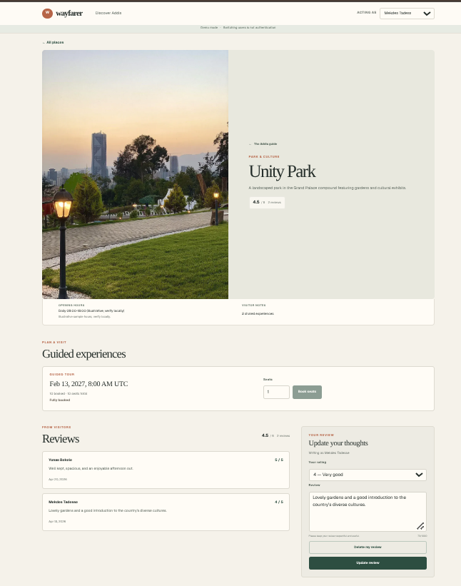

# Wayfarer

Wayfarer is a take-home assignment for place discovery, honest ratings, and
safe tour bookings. The repository includes the SQLite database foundation,
server-side API, and a desktop-first frontend for discovering Addis Ababa
places, sharing reviews, and booking available tour seats. Acting users are
demo identities from the seeded user list; authentication is not implemented.

## Technology

- Next.js 16.4.4 and React
- TypeScript and Node.js
- SQLite through `better-sqlite3`
- Vitest

The assignment requirements are in [`docs/PRD.md`](docs/PRD.md). Accepted
architecture and data-model decisions live in [`DECISIONS.md`](DECISIONS.md).

## Prerequisites

- Node.js 20.9 or later
- npm

## Install and run locally

From a fresh clone, run these commands:

```sh
npm ci
npm run db:seed
npm run dev
```

The development server starts at <http://localhost:3000>. The seed command
creates the default local database and inserts stable sample records. It can
be run again safely; it does not replace existing records. On a fresh
database, it creates three demo users, ten places with reviews, and tour slots.

## Application screenshots

### Discovery


### Place details




## Database

The default SQLite file is `data/wayfarer.sqlite`; the directory and database
file are ignored by Git. Opening the database initializes the schema.

To select another database file, set `DATABASE_PATH` before running the seed
command or application. Relative values are resolved from the process working
directory; absolute paths are used as supplied. For example:

```sh
DATABASE_PATH=/tmp/wayfarer.sqlite npm run db:seed
```

`DATABASE_PATH` is optional, so no `.env.example` is needed. Tests use isolated
temporary SQLite files and do not depend on the local development database.
Seed place opening hours are illustrative sample values, not verified
real-world schedules.

## API surface

The application exposes server-side route handlers for the data layer that is
implemented by the application:

```http
GET /api/places?category=Park&sort=top-rated
GET /api/places?minSeats=4&sort=soonest-available
GET /api/places/:id
GET /api/users
POST /api/places/:id/reviews
DELETE /api/places/:id/reviews
POST /api/tour-slots/:id/bookings
GET /api/tour-slots/:id/bookings
DELETE /api/bookings/:id
```

Examples:

```http
GET /api/places
GET /api/places?category=Museum&minSeats=2&sort=most-available
GET /api/places/national-museum-of-ethiopia
GET /api/users

POST /api/places/national-museum-of-ethiopia/reviews
X-User-Id: user-001
Content-Type: application/json

{"rating":5,"body":"Excellent museum."}

POST /api/tour-slots/slot-entoto-001/bookings
X-User-Id: user-001
Idempotency-Key: 8b596d28-f359-4c79-8fd5-897a2f950e52
Content-Type: application/json

{"seats":1}

DELETE /api/bookings/<booking-id>
X-User-Id: user-001
```

The list endpoint returns place metadata, a `ratingSummary` block, and
upcoming-tour availability summaries. `minSeats` filters for an individual
upcoming slot with that many seats. The place-details endpoint includes
reviews, reviewer names, and tour-slot summaries including booked seats and
remaining seats. Review and booking requests validate runtime input and return
JSON error payloads with stable status codes. `DELETE /api/places/:id/reviews`
uses the `X-User-Id` header to remove only that user's review; deleting an
already absent review succeeds with `{ "deleted": false }`.
Booking creation requires an `Idempotency-Key`. Reusing the same key for the
same acting user and same slot/seat request returns the original booking
result; reusing it for different booking details returns `409
IDEMPOTENCY_KEY_REUSED`. Clients should reuse the key only for retries of one
logical attempt and generate a new key for a new attempt.

`GET /api/tour-slots/:id/bookings` lists the acting user's bookings for that
slot, including active/cancelled status. `DELETE /api/bookings/:id` cancels
only a booking belonging to the acting user. A first cancellation returns
`{ "cancelled": true }`; repeating it returns `{ "cancelled": false }`.
Cancelled bookings remain persisted for status/history, but their seats no
longer count against tour-slot availability and can be booked again.

The frontend at `/` supports backend category and minimum-seat filters, plus
name, top-rated, soonest-available, and most-available sorting. Select a demo
user in the shared header, open a place for its reviews and tour slots, then
submit, update, or delete your review and book available seats. The discovery
and detail views refresh availability on focus and visibility changes, poll
while visible, and synchronize successful bookings across same-browser tabs
when `BroadcastChannel` is available. These updates are not reservations;
the booking endpoint remains authoritative.

## Commands

Available npm scripts:

- `npm run dev` — start the development server.
- `npm run build` — create a production build.
- `npm run start` — serve the production build.
- `npm run db:seed` — insert missing deterministic sample data.
- `npm test` — run Vitest once and exit.
- `npm run test:watch` — run Vitest in watch mode.
- `npm run lint` — run ESLint.

Run the TypeScript check with `npx tsc --noEmit`.

## Limitations

Authentication is not implemented. The “Acting as” selector is a demo
identity switcher backed by seeded users. The `X-User-Id` header is not
authentication and must not be treated as production authorization; ownership
checks in demo mode do not establish a trusted identity.

SQLite is intended here for local development and a single application
instance. Separate instances do not share one SQLite file or a distributed
booking lock; a multi-instance deployment needs a shared database and an
appropriate concurrency strategy.

Booking creation and cancellation serialize their capacity changes in SQLite
transactions, and persisted idempotency keys protect retries across requests
and server restarts. SQLite serializes writers only for processes sharing the
same database file; a multi-instance deployment needs a shared database and
an appropriate distributed concurrency strategy.
